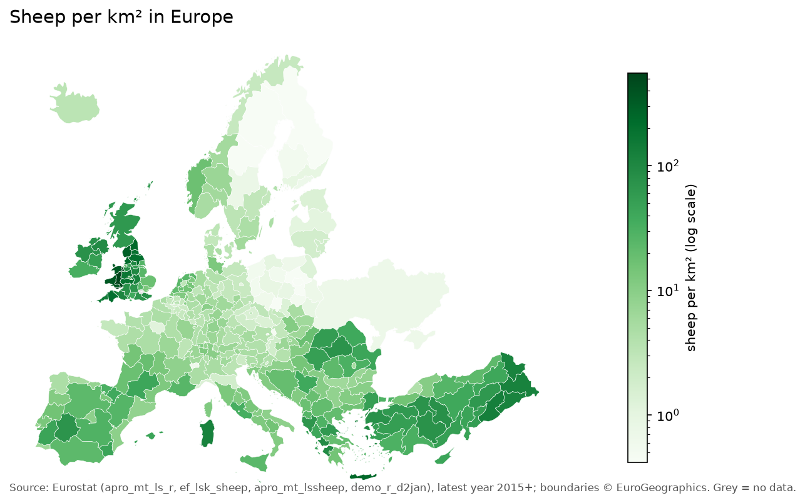
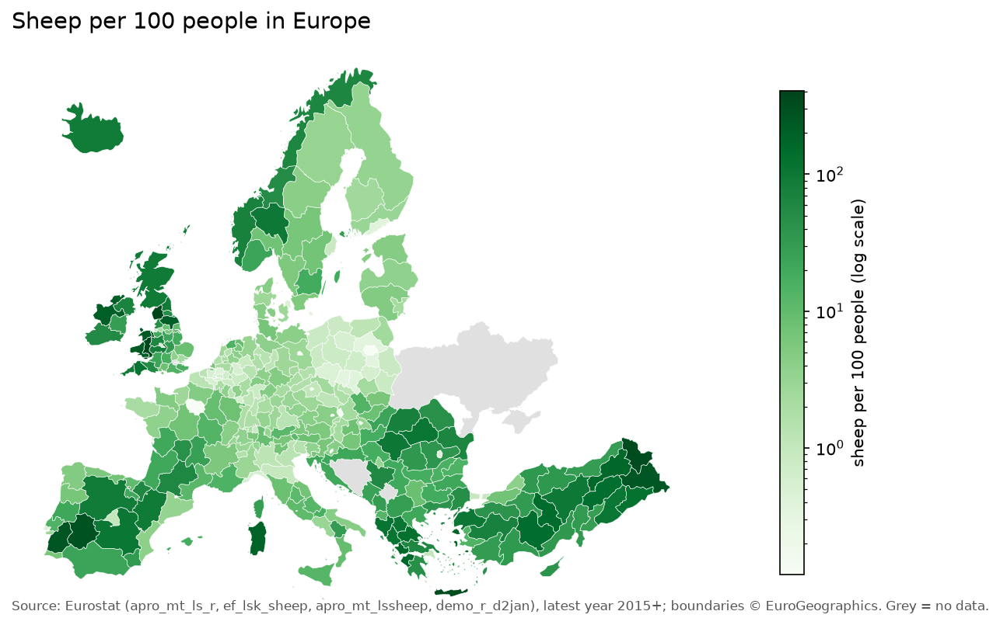
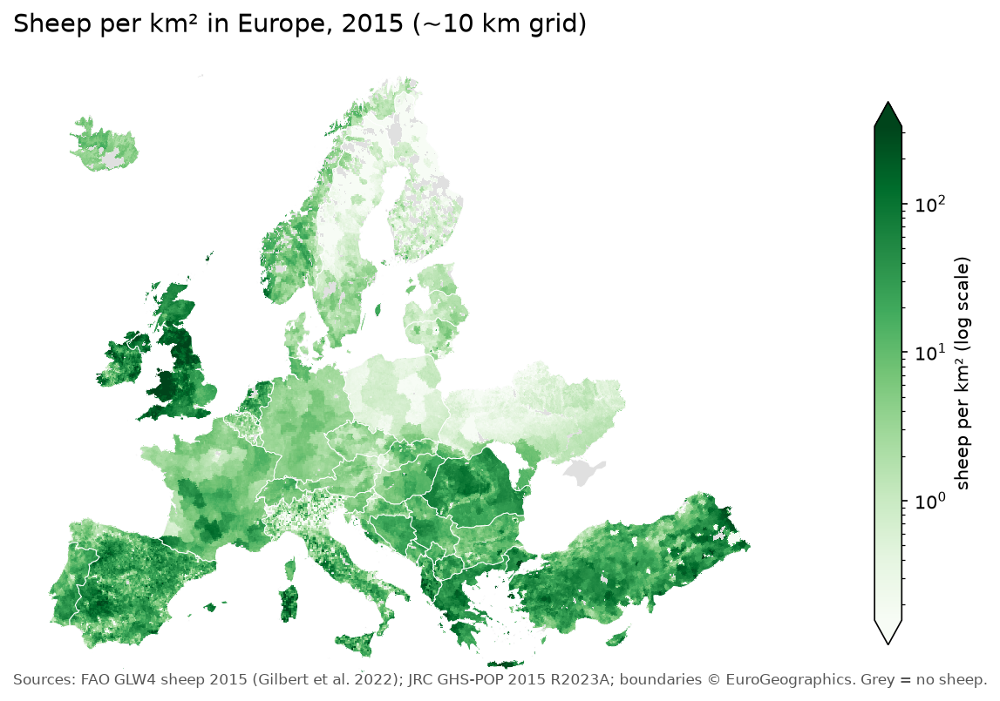
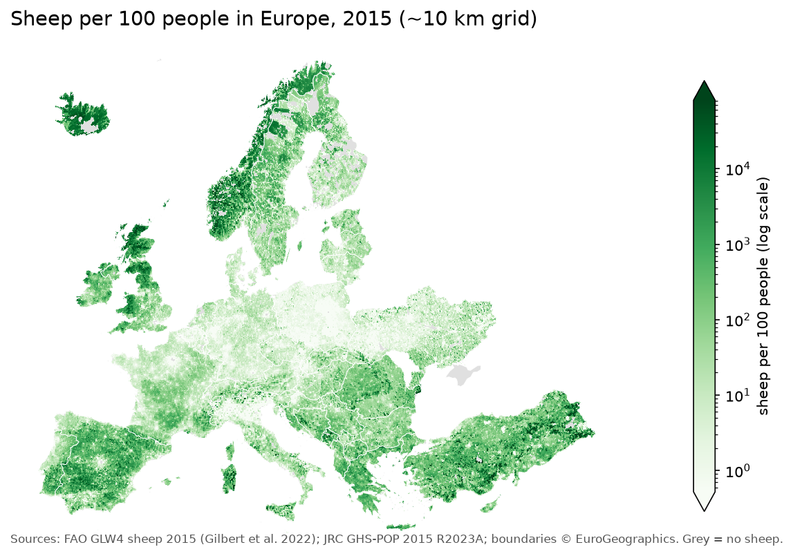
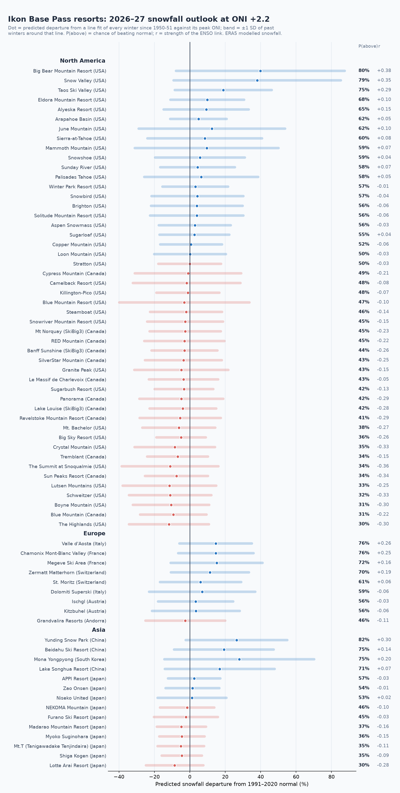

# data-viz

Python data visualizations.

## Sheep in Europe




```
python -m venv .venv
.venv\Scripts\activate          # Windows; `source .venv/bin/activate` elsewhere
pip install -r requirements.txt
python sheep_maps.py            # downloads raw data to data/raw/ (gitignored), writes output/*.png
```

### Data sources

Raw data is not committed. `sheep_maps.py` downloads it on first run (skipped if the file is already in `data/raw/`). Every file comes from public, keyless endpoints:

| File | Source | What |
|---|---|---|
| `apro_mt_ls_r.tsv` | [Eurostat `apro_mt_ls_r`](https://ec.europa.eu/eurostat/databrowser/view/apro_mt_ls_r/default/table) | Animal populations by NUTS 2 region (December survey). Sheep = `animals=A4100`, `unit=THS_HD` (thousand heads). |
| `ef_lsk_sheep.tsv` | [Eurostat `ef_lsk_sheep`](https://ec.europa.eu/eurostat/databrowser/view/ef_lsk_sheep/default/table) | Farm structure survey, sheep by NUTS 2 (2016/2020/2023). Downloaded with the SDMX key `A.TOTAL.TOTAL.TOTAL.TOTAL.A4100.HD.` (all farm sizes, heads) because the full table is about 120 MB. |
| `apro_mt_lssheep.tsv` | [Eurostat `apro_mt_lssheep`](https://ec.europa.eu/eurostat/databrowser/view/apro_mt_lssheep/default/table) | National sheep population. Uses `month=M11_M12`, `animals=A4100`. |
| `demo_r_d2jan.tsv` | [Eurostat `demo_r_d2jan`](https://ec.europa.eu/eurostat/databrowser/view/demo_r_d2jan/default/table) | Population on 1 January by NUTS 2 region (`sex=T`, `age=TOTAL`). |
| `nuts_2024.geojson` | [GISCO NUTS 2024](https://ec.europa.eu/eurostat/web/gisco/geodata/statistical-units/territorial-units-statistics), 1:20M, EPSG:3035 | Region boundaries. |
| `nuts_2016.geojson` | GISCO NUTS 2016, same format | Used only for UK boundaries, because the UK is not in NUTS after 2020. |

Eurostat files come from the SDMX 2.1 API as TSV:
`https://ec.europa.eu/eurostat/api/dissemination/sdmx/2.1/data/<dataset>?format=TSV&compressed=false`.

### Method

- **Sheep count per region:** the latest value from 2015 onward. Sources are tried in this order: `apro_mt_ls_r`, then `ef_lsk_sheep`, then the national total. Different regions can therefore come from different years and surveys.
- **Population:** the latest value from 2015 onward. It is not matched to the year of the sheep count.
- **Region detail:** each region is split into its sub-regions only when every sub-region has both sheep and population data. Otherwise the parent region is shown. As a result, most of Europe is at NUTS 2, but Scotland and London are at NUTS 1, and Ukraine, Bosnia, Kosovo and Liechtenstein are shown at country level.
- **Area:** computed from the geometry in EPSG:3035, an equal-area projection.
- **Map extent:** remote regions are dropped (Canary Islands, Azores, Madeira, French overseas regions). Turkey is included, following Eurostat's coverage.
- **Colour scale:** logarithmic, because values range across about 3 orders of magnitude.

## Sheep in Europe, ~10 km grid (2015)




```
python sheep_grid_maps.py       # first run downloads ~500 MB (mostly the population grid)
```

### Data sources

| File | Source | What |
|---|---|---|
| `glw4_sheep_2015_da.tif` | [FAO GLW4, sheep 2015](https://doi.org/10.7910/DVN/VZOYHM), Harvard Dataverse file 6769626 | Sheep count per 5-arcminute (~10 km) cell. This is the "Da" (dasymetric) variant. Licence CC0. |
| `glw4_area_km2.tif` | Same dataset, file 6769631 | Land area of each cell in km². |
| `ghs_pop_2015_30ss.zip` | [JRC GHS-POP R2023A, 2015, 30 arc-seconds](https://doi.org/10.2905/2FF68A52-5B5B-4A22-8F40-C41DA8332CFE) | Population count per ~1 km cell (480 MB zip, read in place without unzipping). Licence CC BY 4.0. |

The Dataverse URLs (`https://dataverse.harvard.edu/api/access/datafile/<id>`) redirect to a signed S3 link that accepts only GET requests, so a HEAD request returns 403 even though the file is there.

Citations:
- **Sheep:** Gilbert M., Cinardi G., Da Re D., Wint W.G.R., Wisser D., Robinson T.P. (2022). *Global sheep distribution in 2015 (5 minutes of arc)*. Harvard Dataverse, V1.
- **Population:** Schiavina M., Freire S., Carioli A., MacManus K. (2023). *GHS-POP R2023A*. European Commission, JRC.

### Method

- **Matching the grids:** population is summed from the 30" grid into the 5' sheep grid using `rasterio` `Resampling.sum`. The two grids are offset by about 1.5", which is negligible.
- **Countries shown:** cells are masked to the NUTS countries, as in the regional maps. GLW4 has no sheep data for Crimea.
- **Sheep per person:** the population in each cell has a floor of 1 person. Without it, empty upland cells (Scottish Highlands, Norwegian fjells, Iceland) would divide by zero, so these cells show as extreme values instead.
- **Density map artefacts:** GLW4 spreads census totals across cells using a model, so some census boundaries remain visible (for example French departments and German districts).
- **Projection for display:** the results are reprojected to EPSG:3035 at 5 km for display only.

## Ikon Base Pass snowfall in El Niño seasons



```
python ikon_snow.py   # downloads to data/raw/ (cached), writes output/ikon/<resort>.png + summary.png
python ikon_validate.py   # compares with resort-reported and NOAA station totals in data/validation/
python ikon_report.py     # writes output/ikon/report.html (opens the PNGs next to it)
```

Needs a free [Copernicus CDS](https://cds.climate.copernicus.eu) account. Accept the licence on the
[ERA5 time-series dataset](https://cds.climate.copernicus.eu/datasets/reanalysis-era5-single-levels-timeseries?tab=download#manage-licences),
then put your API key in `~/.cdsapirc`:

```
url: https://cds.climate.copernicus.eu/api
key: <your key>
```

The resort list is `data/ikon_base_2026_27.csv`, one chart per 2026-27 Ikon Base Pass ski area. It was compiled from
[ikonpass.com](https://www.ikonpass.com/en/shop-passes/ikon-base-pass); coordinates and elevations are approximate.

- **Snowfall:** [ERA5 hourly point time series](https://cds.climate.copernicus.eu/datasets/reanalysis-era5-single-levels-timeseries)
  (total precipitation, 2 m temperature, surface and sea-level pressure) at the grid point nearest each resort,
  1950 to the present. ERA5's own snowfall is decided on terrain smoothed to about 28 km, often 1,000 m or more below
  the resort. So the script gets the grid cell's height from the two pressures, shifts the temperature to mid-mountain
  at 6.5°C/km, and counts precipitation as snow at or below 0.5°C and as rain at or above 2°C (linear in between),
  at 7:1 snow to water. Totals still differ from resort reports, so the departures from each resort's own
  1991–2020 normal are the meaningful numbers.
- **Seasons:** Northern Hemisphere resorts use July 1–June 30. Southern Hemisphere resorts use the calendar year,
  which is the winter that overlaps a developing El Niño (for example, 2015 for the 2015–16 event).
- **El Niño strength:** [NOAA CPC ONI](https://www.cpc.ncep.noaa.gov/data/indices/oni.ascii.txt), taking the peak of
  NDJ/DJF/JFM in the north and MJJ/JJA/JAS in the south. Weak is 0.5–0.9, Moderate 1.0–1.4, Strong 1.5–1.9 and
  Very strong 2.0 or more. A season in progress is hatched and left out of the summary.
- **Outlook:** for each resort, a least-squares line of % departure against peak ONI over every complete season,
  La Niña included, evaluated at the latest ONI reading. The chance of above-normal snowfall assumes winters
  scatter normally around that line. Results are in `output/ikon/forecast.csv`.
- **Validation:** `data/validation/` holds resort-reported season totals (resort snowfall-history pages and
  OnTheSnow, with the source URL on every row) and NOAA COOP station totals from the
  [RCC-ACIS API](https://www.rcc-acis.org/docs_webservices.html). `ikon_validate.py` compares them with the model
  season by season. California tracks well (r = 0.72–0.95); Taos and the Alps track poorly (r = 0.32–0.55).
